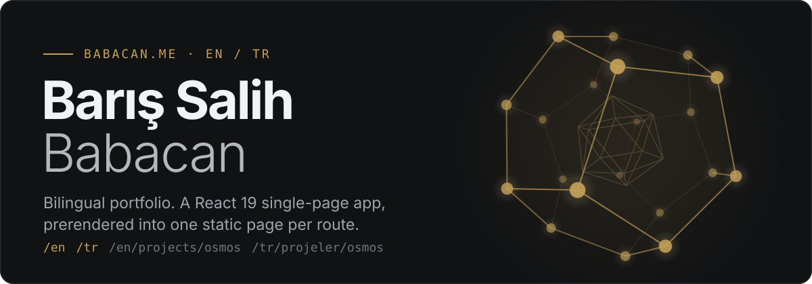
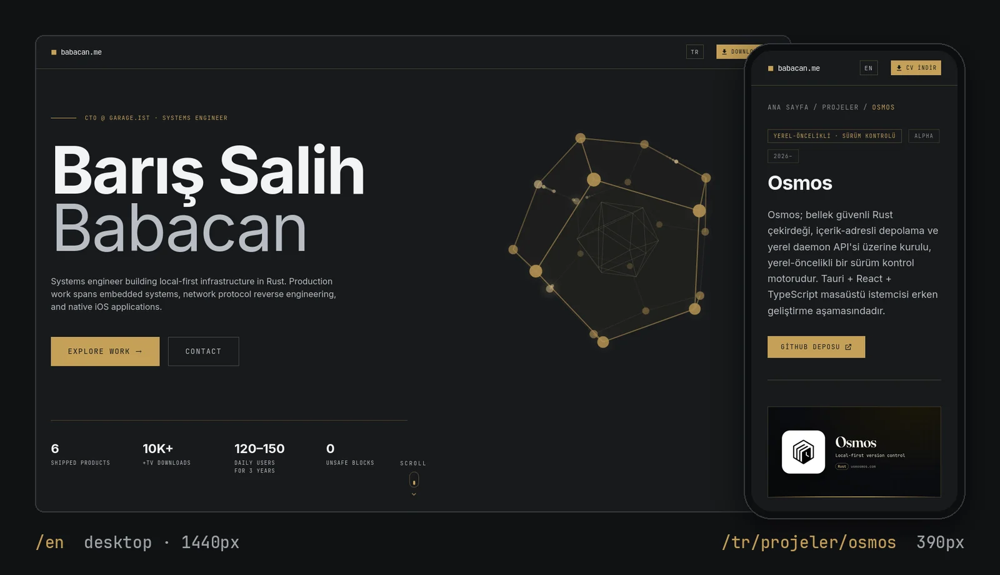
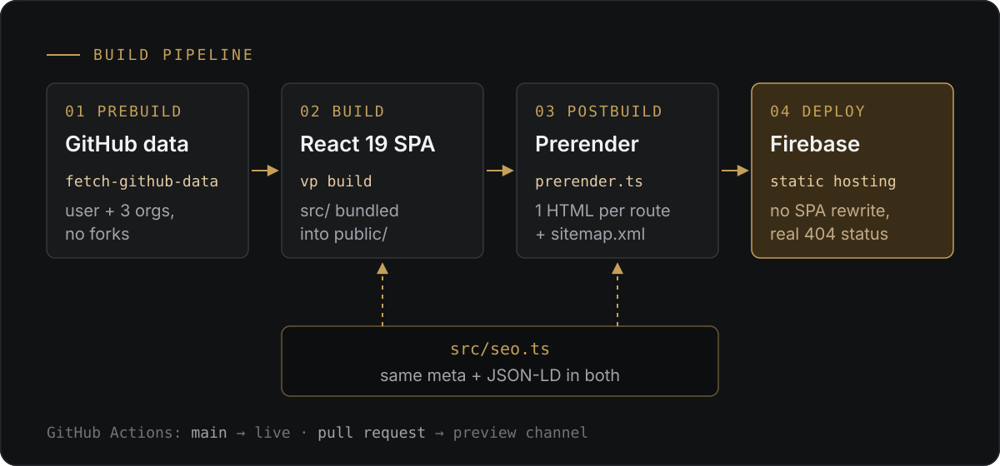

<p align="center">
  
</p>

<p align="center">
  <a href="https://babacan.me"></a>
  <a href="https://github.com/barissalihbabacan/babacan.me/actions"></a>
  <a href="./LICENSE"></a>
</p>

<p align="center">
  
</p>

**[babacan.me](https://babacan.me)** is the personal site of Barış Salih Babacan, a systems engineer. It covers experience, projects and GitHub activity, and every page exists in English and Turkish.

It's a React 19 single-page app with no router or i18n library. At build time each route is also written out as its own static HTML file, so link previews, crawlers and clients without JavaScript get the right title, language and content for that page.

## How it works

<p align="center">
  
</p>

- **URLs carry the language.** Every page lives under `/en` or `/tr` (`/en/projects/osmos`, `/tr/projeler/osmos`). A small History API router in `src/contexts/` turns the path into a page and a language; switching language moves you to the matching URL.
- **One metadata source.** `src/seo.ts` builds titles, descriptions, canonical and hreflang links, and JSON-LD. The app renders it through `react-helmet-async`; `scripts/prerender.ts` writes the same tags into each static page and generates `sitemap.xml`.
- **Static hosting only.** Firebase serves the prerendered files as they are. There is no SPA catch-all rewrite, so an unknown URL returns a real `404`, and alternate spellings like `/tr/projects/*` are 301 redirects.
- **GitHub data is baked in.** Before each build, `scripts/fetch-github-data.js` collects repositories, languages and the contribution calendar for the personal account and the `Osmos-App`, `Mythos-IDE` and `joinchorus` orgs into `github-data.json`. The browser never calls the GitHub API with a token.
- **No 3D library.** The hero dodecahedron is projected by hand and drawn with Canvas 2D. It only mounts on wide screens, pauses offscreen and stays still under `prefers-reduced-motion`.

## Run locally

Requires Node 24 and npm 11+. The toolchain is [Vite+](https://viteplus.dev) (`vp`).

```bash
git clone https://github.com/barissalihbabacan/babacan.me.git
cd babacan.me
vp install
npm run dev        # http://localhost:5173
```

```bash
vp check           # format, lint and type check (no test suite)
npm run build      # GitHub data → vp build → prerender into public/
npm run preview    # serve the production build
```

**Optional GitHub token.** The GitHub data step works without a token, but unauthenticated requests are quickly rate-limited. Copy `.env.example` to `.env.local` and set `GITHUB_TOKEN` (a classic token with the `public_repo` scope is enough); the prebuild step loads `.env.local` itself. The token is read only at build time and never reaches the browser. Don't give it a `VITE_` prefix, since Vite exposes `VITE_*` variables to client code. If the fetch fails, the build keeps the existing `github-data.json` and carries on.

## Where things live

| To change                               | Edit                                                      |
| :-------------------------------------- | :-------------------------------------------------------- |
| UI text (EN + TR)                       | `src/data/i18nData.ts`                                    |
| Projects and project pages              | `src/data/projectsData.ts`                                |
| Page titles, descriptions, JSON-LD      | `src/seo.ts`                                              |
| CVs, diagrams, `robots.txt`, `llms.txt` | `src/public/`                                             |
| Colors and type tokens                  | `src/styles/main.css`, spec in [`DESIGN.md`](./DESIGN.md) |

The build writes to `public/` at the repo root, which is what Firebase serves; don't edit it by hand. Pushes to `main` deploy to the live site, and pull requests get a preview channel.

## License

[MIT](./LICENSE) © Barış Salih Babacan
